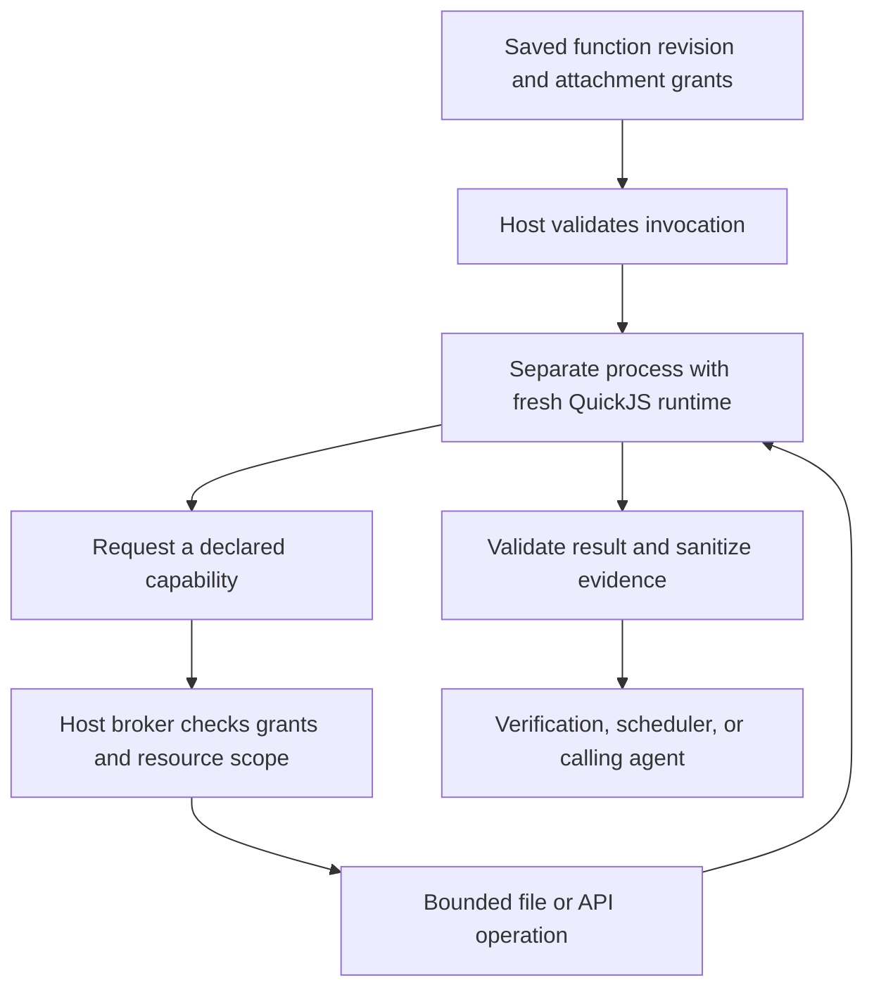
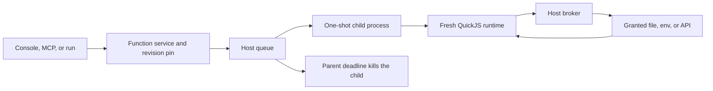
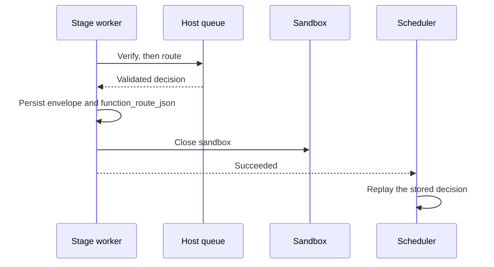
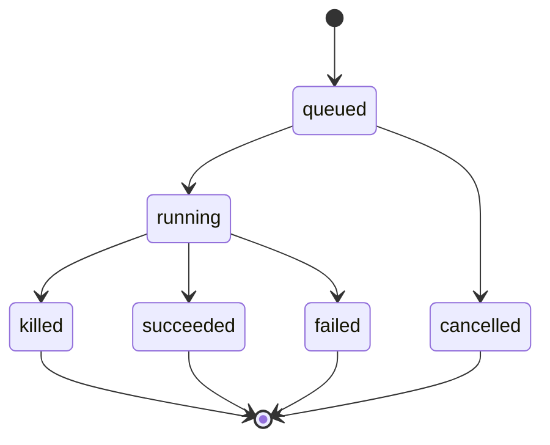

# Reusable JavaScript functions - Plan

## Goal Capsule

- **Objective:** Operators can author reusable JavaScript behavior centrally, attach it to pipeline stages and agents, and inspect its execution without modifying Stageflow source code.
- **Means:** Project-owned function files, immutable revisions, and one QuickJS process per call (KTD1, KTD3).
- **Authority:** This document is the implementation source of truth. Product Contract requirements are unchanged. The Planning Contract owns how those requirements are built. Earlier conversation sketches are not competing specifications.
- **Open product blockers:** None. Q1–Q6 are closed by the Planning Contract.
- **Execution:** One pull request. U1–U8 land in dependency order inside it. The implementer who executes this plan finishes and ships that pull request.
- **Stop:** Do not weaken eval gates, expose Node or shell to guest code, change legacy `if` joins, or treat an invalid function file as the previous good revision.
- **Delivery boundary:** The feature is not implemented. Persistence, execution, authoring, observability, documentation, and acceptance coverage are all required for completion.

---

## Product Contract

### Summary

Build the catalog on the agent file-and-revision store, and run each call in a new QuickJS process the Host can kill. The console, project files, and the existing HTTP and MCP writers share that catalog. A function attached to an agent stays off public web chat.

### Problem Frame

Pipeline and agent authors need project-specific checks, decisions, and tools without maintaining application patches or deploying a separate service. Pure computation alone cannot check generated files or use environment configuration. Unrestricted Node.js execution would expose far more authority than these tasks require.

### Actors

- **Operator/author:** Creates functions, configures capabilities and bindings, attaches functions, and authorizes real test executions.
- **Stage or project agent:** Calls an exposed tool using its declared input schema; it cannot grant permissions or edit the effective execution policy.
- **Host:** Resolves revisions and bindings, enforces capabilities, schedules execution, and persists sanitized observations.
- **Implementer/reviewer:** Uses this specification to build and verify the complete feature, preserving existing pipeline and agent contracts.

### Key Decisions

- D1. **Use QuickJS through `quickjs-emscripten`.** (session-settled: user-approved — chosen over `isolated-vm`, SES alone, and a home-grown sandbox: separate interpreter state, explicit host bridges, and execution limits fit the feature.) Governs R10–R14.
- D2. **Use restricted capabilities rather than requiring purity.** (session-settled: user-directed — chosen over pure-only execution: verification needs file inspection and environment access.) Governs R15–R20.
- D3. **Custom tools define their own arguments.** The user explicitly clarified that both stages and agents pass available data according to each tool's description and schema; arguments are not constrained to envelope fields. Governs R8, R29–R32.
- D4. **Keep one kind per function.** This implementation default makes attachment compatibility and result validation unambiguous. Governs R2, R9.
- D5. **Pin implementations when execution starts.** Existing agent revisions and pipeline snapshots provide the model for reproducibility. Governs R5–R6.
- D6. **Extend existing verification and scheduling semantics.** Function execution supplies evidence and route decisions; the pipeline engine retains lifecycle ownership. Governs R21–R28.
- D7. **Use trusted operator authoring with restricted execution.** Generated source and model-supplied arguments still require validation and containment. Governs R10–R20, R38.

D1–D3 record explicit conversation decisions. Other decisions and the detailed defaults below resolve the supplied requirements against the current repository; they are not represented as separately negotiated user choices. Implementation plans may choose internal structures, but must record any proposed change to these product behaviors in this document before implementing it.

### Requirements

**Catalog, persistence, and revisions**

- R1. Functions must be project-owned, centrally discoverable definitions editable through the console and project files.
- R2. Each definition must have a stable ID, display name, optional description, one immutable kind, JavaScript source, applicable schemas, timeout, declared capabilities, binding references, and creation/update metadata.
- R3. Create, edit, duplicate, and delete must use one validated write path with atomic file replacement, conflict detection, and recoverable synchronization with revision storage.
- R4. Deleting a function must show its usages and be blocked while current pipeline, reusable-stage, or agent definitions reference it.
- R5. Every successful function edit must create an immutable revision covering source, schemas, capabilities, bindings, and execution settings.
- R6. Runs and agent sessions must resolve and persist their function revisions before execution, retaining those revisions across retries, resume, and process restarts.
- R7. Catalog validation and execution preflight must reject missing, incompatible, invalid, or insufficiently granted attachments before invoking an agent or function.

Definitions belong under the project's `functions/` directory as `*.function.yaml` files, with source stored as a multiline JavaScript value in the definition. This follows the project's file-owned authoring model and avoids independently versioning a source file and its metadata. The final field spelling and migration layout are planning choices; the fields in R2 are mandatory. Revisions and execution history belong in persistent Host storage, scoped to the project.

An ID and kind cannot be changed in place. Duplicate creates a new ID and independent revision history. Duplicated definitions retain requested capabilities and binding references, but confer no grants on new attachments. Created metadata remains stable; updated metadata and the content hash change on edits. Source validation must parse code without executing its module body.

For R3, external file edits must be detected and indexed into revisions. Invalid external edits produce visible findings and block new executions that reference the invalid current definition; they must not silently use the last valid revision. Existing pinned executions remain valid. A partially failed file/database save must be reconciled before it becomes runnable.

For R4, usage discovery covers configured catalog roots, reusable definitions, and persisted reference/origin information for explicitly loaded configurations. If references cannot be safely enumerated because a relevant catalog is unreadable, deletion fails closed. A configuration introduced later with a deleted ID fails R7. Historical runs and sessions retain their referenced code and records after the live definition is deleted; no cascade may erase that evidence. Direct file deletion receives the same broken-reference treatment on the next scan.

For R5–R6, references in editable configurations select the current valid function revision when a new run/session starts. All stages in that run, including later branches and retries, use the captured revision map. Existing always-on agent sessions retain their map until a new session is created. A resume must never silently re-resolve to the latest code. Persist a source hash and runtime-contract version alongside the revision identity. Reproducibility identifies code and policy; it does not freeze external files, API responses, or rotated credentials.

**Invocation and data contracts**

- R8. All functions must use `export default function execute(context)` or its `async` equivalent, and execution must await either form consistently.
- R9. Inputs and outputs must be strictly JSON-serializable data validated against the kind contract and any applicable authored schema.

`context` contains data snapshots and narrow runtime-provided interfaces. Data passed into the interpreter is copied; mutations cannot change the pipeline, an envelope, an agent definition, or Host objects. No live application objects cross the boundary. Unsupported values such as `undefined` results, non-finite numbers, BigInt, functions, cyclic values, and class instances must be rejected rather than silently coerced or truncated. Runtime-provided logging, file/API interfaces, and cancellation are capabilities, not serialized user input.

The context contract is:

| Field | Verification | Routing | Tool |
| --- | --- | --- | --- |
| `kind` | `verification` | `routing` | `tool` |
| `input` | Optional authored check parameters, otherwise `{}` | Optional authored routing parameters, otherwise `{}` | Validated model-supplied arguments |
| `envelope` | Candidate success envelope being checked | Verified success envelope being routed | `null`; arguments are supplied explicitly through `input` |
| `children` | Absent | Eligible declared forward destinations, each with `id`, `name`, and routing description | Absent |
| `execution` | Project/run/stage/attempt/check/phase identifiers | Project/run/stage/attempt identifiers | Available project/run/stage/attempt/agent/session/tool-call identifiers |
| `env` | Explicitly bound configuration values | Explicitly bound configuration values | Explicitly bound configuration values |
| `files` | Granted read operations | Granted read operations | Granted read operations and any explicit output-write grants |
| `api` | Granted read operations | Granted read operations | Granted read or action operations |
| `log` | Bounded diagnostic logging | Bounded diagnostic logging | Bounded diagnostic logging |
| `signal` | Runtime cancellation interface | Runtime cancellation interface | Runtime cancellation interface |

`execution` always identifies the function ID, revision, and invocation ID. Inapplicable execution identifiers are absent. The runtime must not infer sensitive context from the caller's arguments or automatically supply the current conversation, entire environment, or application state. For a tool, a stage or agent may explicitly pass an envelope, file contents, or other data it has access to if the tool's schema asks for it. Standalone agents require no pipeline envelope.

Read-only context snapshots mean isolation from Host state, not a promise that JavaScript never changes its local variables. Authorized external operations are the only permitted persistent effects.

`signal` is a guest-side cancellation interface; it must not expose a live Host object. Runtime interruption and process termination remain authoritative when code ignores the signal.

**Execution boundary and limits**

- R10. User source must execute inside a fresh QuickJS runtime provided by `quickjs-emscripten`, hosted outside the application server's event loop in a separately terminable process.
- R11. Execution must expose only the approved JavaScript surface and explicit capabilities, without ambient Node, filesystem, process, network, or module-loading access.
- R12. Every invocation must have finite wall-clock, interpreter-memory, stack, input/output, log, I/O, and host-call budgets, with bounded admission concurrency and queue length.
- R13. Timeout and cancellation must terminate execution and cancel pending Host operations, including when code loops indefinitely or repeatedly schedules promise jobs.
- R14. Function tests and production invocation must share the same executor, capability checks, budget enforcement, and result validators.

The supported surface is JavaScript supported by the pinned QuickJS build, JSON data handling, promises, and the interfaces in R8–R9. External module imports, package installation, native addons, `require`, `process`, shell execution, direct filesystem APIs, and unrestricted `fetch` are unavailable. The entry module may define private helpers. No arbitrary cross-function imports or recursive function invocation are introduced in this release. Exact optional globals are documented before release; callers cannot assume Node or browser compatibility.

A fresh runtime prevents state leakage between invocations. The Host must reliably dispose QuickJS handles and pending jobs on all outcomes. The worker starts with a minimal execution environment; credentials and application state are not inherited as its general environment. The broker authenticates invocation ownership from Host-established state, not IDs or claimed permissions supplied by function code.

QuickJS interrupt handlers and allocation limits are the first line of enforcement. An independent parent deadline must kill the process if it cannot stop cooperatively. Deadlines cover module initialization, execution, promise draining, capability calls, and result serialization. Cancellation removes queued work and prevents new capability calls. Use bounded process resources in addition to interpreter limits; prove containment of allocation pressure during the runtime feasibility checks. A same-user child process is not an OS security boundary.

Queue admission must be bounded across the Host, including CLI-started work and stage workers; multiplying the number of workers must not multiply an unbounded allowance. A full queue produces an explicit resource-limit result. Cancellation and finalization must leave no orphan worker or unresolved broker request. Host file reads, HTTP bodies, IPC, logging, and schema validation need independent size/complexity limits because QuickJS heap limits do not constrain them.

Numeric defaults, upper bounds, and supported platform enforcement are implementation-planning deliverables under Q2. The feature cannot be considered complete with unspecified or unenforced limits.

**Capabilities, files, environment, and API access**

- R15. Effective permissions must be the intersection of function-declared capabilities, explicit attachment grants, and Host policy.
- R16. Verification and routing functions may inspect granted resources but must not receive write or side-effecting action capabilities.
- R17. File capabilities must operate on approved logical roots and paths in the execution's actual workspace or artifact scope, with confinement and bounded access enforced by the Host.
- R18. Environment bindings must expose only explicitly mapped values resolved at invocation time, with missing required bindings reported as errors.
- R19. API calls must use declared Host-mediated operations with destination, path, method, credential, and response limits enforced independently of user code.
- R20. Secret values must remain out of source, configuration exports, browser responses, function results, logs, and persisted diagnostic evidence.

R15 grants are explicit at the usage site: an attached verification, routing function, stage tool, or agent tool. Broader workspace/pipeline/stage/agent environments and tool grants do not automatically become function permissions. A definition may supply default binding references; an explicit usage-level binding replaces a declared alias, subject to the attachment grant and Host policy. Unknown aliases and ambiguous duplicates are rejected. Host denials and permanent secret denials always win.

A function revision requesting additional permissions cannot silently acquire them when the next run/session starts. Existing attachment grants remain unchanged; validation requires the operator to grant the newly requested access. Active runs keep pinned code/grants but remain subject to current Host denials and credential availability. Capability removal or revocation must not be bypassed by resuming a run.

For R16, computation, selected environment values, file inspection, and explicitly authorized API read operations are supported. A tool may additionally receive named API action permissions or narrowly scoped output-file writes. Initial file operations are `exists`, `stat`, `readText`, and `readJson`, plus explicit tool-only output writes; arbitrary filesystem deletion and shell access are excluded. Existing command verifications remain a separate mechanism and cannot be invoked as a sandbox escape through a function.

For R17, logical roots include the current attempt's artifacts and explicitly granted workspace paths; standalone agents use explicitly granted project resources. A path argument never grants access. Reject absolute host paths, traversal, symlink escapes, special devices, and protected credential/configuration stores. Use race-resistant access rather than checking a path once and later opening a different target. A stage executing in a container must inspect that container's actual permitted files, not a stale or broader Host directory. Prior-stage artifacts are available only through the stage's existing grants. Reads are not assumed to be stable across repeated invocations; useful evidence can include a file digest without storing its content.

For R18, values are copied into `context.env` by alias; there is no `process.env` enumeration and no implicit `.env` file access. Required values missing from either the configured environment source or secret store produce a binding error before user execution. Optional values are absent rather than guessed. Do not expose infrastructure control tokens or provider credentials merely because the Host possesses them.

For R19–R20, credential bindings belong to named API operations. The Host resolves stored secret references and injects authentication into the permitted request; raw credential bytes are not exposed through `context.env` or a `getSecret` function in this release. Non-secret configuration remains available through R18. This deliberately narrows the original general secret-binding idea to reduce opportunities for source code to leak credentials. Arbitrary custom credential processing requires a separately designed capability, not an unrestricted secret escape hatch.

API operations must constrain origin, permitted paths, HTTP methods, and request fields. The broker prevents model arguments from replacing authentication, authority, or protected headers. Public HTTPS destinations are the initial network scope; loopback, private/link-local ranges, cloud metadata services, and unsupported protocols are denied. DNS resolution, the actual connection address, redirects, and proxy behavior must all preserve that rule. Do not forward credentials to a new destination on redirect. Requests, responses, headers, outstanding requests, and redirect counts are bounded. An HTTP GET is not proof that a service operation has no side effects: operators explicitly classify permitted read operations, and the UI exposes that declaration.

Function source is trusted operator-authored, but arguments and external responses are untrusted. A malicious author can misuse authority explicitly granted to a function, and arbitrary encoded sensitive data cannot be reliably removed by a redaction heuristic. Therefore capabilities minimize authority and raw secret exposure; redaction is an additional output safeguard, not the security boundary. Code validation may reject unsupported operations and suspicious patterns, but must not label a function "proven safe."

**Verification integration**

- R21. Function verification must integrate with existing `verify` authoring and both supported phases, defaulting to the after phase.
- R22. A verification must return `{ passed: boolean, message?: string, details?: JsonValue }`, distinguishing a valid failed check from execution or contract errors.
- R23. Verification ordering, aggregation, and recovery must preserve the existing phase-specific behavior before downstream routing is released.

For R21–R23, `when: [emit]` checks execute inside successful-envelope acceptance in declaration order and stop at the first failure. They reject the emit through the existing tool error path so the agent can correct it. Failure envelopes continue to bypass success verification; checking must not block failure reporting. After-phase checks execute in declaration order and collect all normal check outcomes, requiring all to pass. Cancellation interrupts evaluation rather than fabricating failed evidence for remaining checks.

After-phase results use distinct passed/failed/error outcomes. `passed: false` is business verification failure; an exception, timeout, missing binding, denied capability, or malformed result is an execution error. Both prevent success acceptance, with their distinction retained in history and repair guidance. Existing `on_verify_fail` repair/manual policies apply; automatic stage repair still requires the explicit idempotent retry-safety declaration and attempt limit. There is no separate hidden function retry loop. Manual re-verification uses the run's pinned revision and may observe newer external data.

Verification and routing result objects reject additional fields and incorrect field types. Tool output extensibility follows its authored output schema, subject to R9.

**Routing integration**

- R24. A stage may attach one routing function that runs after successful verification and before releasing its forward successors.
- R25. Routing must return `{ nextStageIds: string[], reason?: string }`, selecting only distinct IDs from the eligible children supplied by the engine.
- R26. Selected routes must use the existing scheduler, concurrency limits, graph constraints, skip propagation, and join lifecycle.
- R27. Routing execution or contract errors must fail explicitly without silently selecting a destination or replaying successful stage work.
- R28. A validated routing decision must be durably associated with the stage attempt before any selected successor is scheduled.

A stage uses route `if` or one routing function. `sf validate` rejects a stage that has both (`function.routing_conflicts_with_if`). The function selects from the stage's declared forward routes, which have no `if`. Children contain stable stage-definition IDs, names, and optional author-supplied routing descriptions, not arbitrary Host paths or unrestricted child configuration. Duplicate, unknown, ineligible, non-string, or malformed selections fail. A function cannot invent an edge, choose an ancestor, mint clone IDs, or bypass schema compatibility.

Multiple selected IDs allow fan-out subject to scheduler capacity; the function itself never launches stages. An empty selection intentionally completes that branch and skips its unselected downstream paths as appropriate. It does not cancel unrelated parallel branches or declare the entire run complete. Terminal stages may omit routing; a configured routing function sees no children and can only validly return an empty selection.

For R26, record explicit selected/unselected decisions on function-controlled edges. Existing pipelines without functions retain their current conditional-route and join behavior. When a succeeded parent has a function-controlled edge to a join, that edge must have been selected for the join to run; an explicit function exclusion cannot become an implicit inclusion because another parent skipped. Wait for all declared parents to settle before classifying the join. Preserve the existing failed-parent block and all-skipped behavior. This additional function-edge constraint is an implementation default; do not generalize it into a change to legacy `if` behavior.

Loop control keeps priority: when the existing loop mechanism sends work back, no forward function selection is released for that attempt; when it continues, the routing function controls eligible forward routes. Selecting a Clone Chain's declared forward entry permits its normal engine-owned expansion; the function cannot change clone counts, payloads, or instance identities. Skipping that entry does not create clone workers. Scheduling tests must cover these compositions.

For R27, the failure identifies routing as the failed operation and leaves no downstream selection. Operator recovery may re-evaluate routing against the stored verified envelope and pinned function without automatically rerunning the stage's agent or side effects. A new stage attempt through explicit retry remains available through existing controls. No fallback policy is introduced in the first version.

For R28, recovery reuses a committed decision rather than executing the function again. An interrupted invocation with no committed decision may be retried as a read operation, with a new invocation record. Downstream scheduling remains idempotent across crashes after the decision is written.

**Custom tools for stages and agents**

- R29. A tool-kind function must declare a provider-compatible tool name, a useful description, and an argument JSON Schema with field descriptions and required inputs.
- R30. Both stages and agents must expose attached functions through their existing tool registration and execution mechanisms.
- R31. Tool invocation must validate model-supplied arguments before execution and validate the returned JSON value against any optional output schema.
- R32. Tool exposure must preserve grants, approvals, eval policy, cancellation, and established result/error channels without treating a custom function as an internal exempt tool.
- R33. Automatic retries must not repeat a tool invocation with possible external side effects.

The author defines what arguments a tool needs. The agent constructs those arguments from accessible information; the runtime does not restrict them to a predefined envelope or auto-read missing data. Provider tool parameters use an object schema; its properties may contain the supported JSON types. Documentation and UI must disclose the supported schema subset, and runtime validation remains authoritative even when a provider supports constrained sampling.

Reject collisions with built-ins, MCP tools, other custom tools, reserved/internal names, and names after backend normalization. Validate known collisions while authoring and recheck dynamically discovered names before opening the session. Stages and project agents are separate execution contexts: neither automatically inherits the other's function list. A sub-agent uses its own definition and grants, not an implicit union with its caller. All supported execution backends must expose equivalent function contracts, or explicitly reject an unsupported attachment before work starts; silent omission is forbidden.

A business outcome such as `{ found: false }` is an ordinary successful result unless the function throws. Exceptions, invalid inputs/results, capability denials, timeouts, and cancellations use the established tool error channel and sanitized codes. A result must not bypass the normal tool-output budget or acquire instruction/permission authority because it came from a custom tool.

For R32, eval sessions without a registered gate continue to deny every tool. Under default non-real eval policies, external or unknown-risk operations remain stubbed/mocked unless allowed by the existing explicit read-only declaration mechanism. A function's label alone is not proof of read-only behavior. Explicitly consented `real` policy may execute granted functions under the existing restrictions; eval calls must not create approval rows. Function revision hashes and capability policy must participate in relevant eval snapshots/fingerprints so changed implementations are not compared as identical configurations.

For R33, cancellation or timeout does not prove an external operation was undone. Record uncertain external outcomes distinctly and do not resend automatically. An agent can propose another call through the normal tool path, but error messages must make uncertainty visible. Idempotency, when supported by a named API operation, must be honored across transport retries; it is not a general permission to rerun source code.

**Functions page, attachment authoring, and testing**

- R34. Add a Functions page in the console's Build navigation with create, view, edit, duplicate, delete, name search, and kind filtering.
- R35. The editor must provide JavaScript highlighting, syntax and schema feedback, metadata/capability/binding controls, compatible starter templates, revision information, and linked usages.
- R36. Pipeline and agent authoring must show compatible functions, their contracts and requested permissions, invalid references, and navigation to the definition.
- R37. The test interface must accept use-case-appropriate sample inputs and display validated output, duration, sanitized logs, and actionable errors.
- R38. Tests must default to mocked external resources and require an explicit per-test choice before accessing real files, environment bindings, credentials, or API operations.

Use existing directory rows, page headers, editor/problem panels, dialogs, and run-inspector conventions; follow `ui/AGENTS.md` and the component map. The editor separates source/contract, permissions/bindings, test inputs/results, and usages/history into clear regions. Do not require a new package/service build step for authoring.

The tool template explains its argument schema and receives sample tool arguments. Verification templates receive a sample envelope and optional parameters. Routing templates additionally receive eligible child descriptors. Test metadata is marked synthetic and cannot spoof a production run or obtain its grants.

Unsaved source may be tested through the same validation and runtime path using an ephemeral source hash; it does not become a published revision or affect attachments. Test history must clearly distinguish that source from a saved revision. Mock files, environment values, and API responses are explicit fixtures; missing fixtures fail clearly rather than falling back to real resources. A real test selects a resource scope and permissions subject to the same Host ceilings, shows intended actions, and cannot expand an attachment's authority. No blanket consent is inherited from an unrelated previous test.

**Errors, observability, and compatibility**

- R39. Each invocation must record its function/revision/source identity, kind, attachment, applicable execution identifiers, duration, status, and bounded sanitized diagnostics.
- R40. Errors must distinguish syntax, input, output, exception, timeout, cancellation, resource exhaustion, permission denial, missing binding/reference, and uncertain external outcome.
- R41. Invocation history must be accessible from function tests, stage verification/routing views, and agent/stage tool-call views as applicable.
- R42. Existing configurations without function attachments must retain their behavior, public output contracts, and recovery semantics.
- R43. The complete feature must include documentation, representative examples, meaningful tests, and installation/build packaging for the QuickJS runtime assets.

For R39–R41, record capability operation identity and outcome without raw credentials, request URLs containing sensitive data, or response bodies by default. Do not indiscriminately persist envelopes, tool arguments, file contents, or results. Verification diagnostic details and routing reasons are size-bounded and sanitized before any user-facing presentation or persistence. Historical source access remains an operator capability, not a public-agent or web-chat response. Retention must preserve referenced revisions for retained runs/sessions.

Define stable public error codes and map them to actionable messages; planning chooses their exact names. Source locations may be shown after sanitization. Provider response bodies and arbitrary exception objects must not be directly interpolated into errors. An optional binding deliberately left unset is not a missing-required-binding failure.

For R42–R43, loader changes must extend Author YAML (`verify` and pipeline-owned wiring) through the existing compilation path, not introduce runtime IR keys as new YAML authoring syntax. Reusable stage checks/tools belong on their stage body; routing remains pipeline wiring. Attachments and capability overrides must obey the same body/wrapper ownership rules the new schema explicitly declares. Preserve legacy reads and defaults, and provide migrations for persisted data. CLI runs, host-down resume, HTTP-triggered runs, and MCP-triggered runs must share the same function resolution and executor behavior. No implementation may work only while the Functions page is open.

**Access declared in source**

- R44. A function may declare its access as the first statement of its source, `export const access = <object literal>;`. The Host reads that literal when the definition is parsed and derives the capability and binding lists from it. Only whitespace and comments may precede the statement. Any other `export const access` or `export let`/`export var access` is invalid. The literal is parsed, never evaluated.
- R45. When that declaration is valid, it is the source of truth. The stored file omits `capabilities` and `bindings`. A submitted definition that also carries those fields must omit them or match the derived lists; a mismatch is rejected. The parsed definition, grants, preflight, attachments, and history still expose the derived capability and binding arrays. A function with no declaration keeps explicit `capabilities` and `bindings`.
- R46. Guest code may call `context.artifacts` and `context.workspace` (`exists`, `stat`, `readText`, `readJson`, `list`, `write`) with the root already chosen, and `context.files.list(root, path)`. These are wrappers over the same host file operations and the same grants. `list` is a read of one directory, at most 1000 immediate children, with sensitive entries and escaping symlinks omitted. `write` and API `action` stay tool-only.

R44 accepts only an object literal: objects, arrays, strings (single or double quotes, simple escapes, no templates), `true`/`false`/`null`, numbers, comments, and trailing commas. Spread, computed keys, calls, other identifiers, getters, and functions are rejected with a line and column. Keys are `artifacts` and `workspace` (`"none"`, `"read"`, or `"write"`, default `"none"`), optional `files` (path-scoped `{ root, path, access }`), `env` (names, with a trailing `?` for optional), and `network` (an `https` origin string, or an object with origin, effect, methods, path, and credential). `write` and network `effect: "action"` are tool-only. Derived capability ids are deterministic: `artifacts`, `workspace`, `env_` plus the lowercased alias, `api_` plus a slug of the origin host (and `_port` when the port is not the default), and `file_` plus the root and a slug of the path. A collision appends `_2`, `_3`, in declaration order.

R45 does not change how a grant is checked. Attachments still name capability ids. A save that changes the derived capabilities still requires those attachments to be granted again. Sandboxed code cannot widen the declaration or replace `context.artifacts`, `context.workspace`, `context.files`, `context.http`, `context.env`, `context.log`, or `context.signal`.

R46's `list` names a directory relative to the root (`""` or `"."` is the root). The grant's prefix must cover that directory: a grant for `reports/summary.md` does not allow listing `reports`. The result is `{ name, type: "file" | "directory", size }`, immediate children only, sorted by name. More than 1000 entries fails. A missing directory is not found. A non-directory is `not_a_directory`. A denied path uses the same permission denial as other file reads and does not reveal whether the path exists. Sensitive names, devices, sockets, and symlinks whose target leaves the root or is sensitive are omitted, not reported as errors. The same rules apply when the stage root is a container.

### Key Flows

- F1. **Author and attach.** An operator creates a function from a kind template, defines source and contracts, runs sample tests, saves a revision, and attaches it with the required grants. Compatible pickers and preflight enforce R1–R9 and R34–R38.
- F2. **Verify and route.** A stage produces a candidate success envelope, its configured emit/after checks run, the verified result reaches routing, and a durable selection releases engine-owned scheduling. Failures follow R21–R28.
- F3. **Call a custom tool.** A stage or agent sees the registered description/schema, supplies arguments, passes normal policy checks, and receives a validated result or tool error under R29–R33.
- F4. **Inspect resources.** The interpreter requests a permitted file or API operation; the Host verifies the invocation's grants and scope, performs bounded I/O, and returns copied data under R10–R20.
- F5. **Edit during execution.** Saving a newer revision updates future executions while the current run/session continues with its original revision map; history identifies both under R3–R7 and R39–R41.
- F6. **Recover or cancel.** The Host terminates active execution or removes queued work, retains sanitized evidence, and uses the existing recovery surface without silently repeating external actions under R13, R23, R27–R28, and R33.

The execution flow below illustrates F2–F4; the requirements above remain authoritative.



### Authoring Examples

These examples illustrate the invocation contract; they are not executable fixtures or a substitute for the final YAML schema.

**Verification with file and configuration access — covers R8–R9, R16–R18, R22, R44–R46.** The source declares a read of the attempt artifacts and the non-secret `MIN_SCORE`. The Host derives the capabilities. The attachment grants those derived ids.

```js
export const access = {
  artifacts: "read",
  env: ["MIN_SCORE"],
  network: [],
};

export default async function execute(context) {
  const report = await context.artifacts.readJson("report.json");
  const threshold = Number(context.env.MIN_SCORE);
  if (!Number.isFinite(threshold) || typeof report.score !== "number") {
    throw new Error("Expected a numeric report score and configured threshold");
  }
  return {
    passed: report.score >= threshold,
    message: report.score >= threshold ? "Score accepted" : "Score below threshold",
  };
}
```

**Legacy verification — same contract, explicit capabilities.** A module with no `access` declaration still declares `capabilities` and `bindings` on the file. `context.files.readJson("artifacts", "report.json")` remains valid.

```js
export default async function execute(context) {
  const report = await context.files.readJson("artifacts", "report.json");
  return { passed: report.score >= Number(context.env.MIN_SCORE) };
}
```

**Routing based on the verified output — covers R24–R26.** The output payload includes the requested next destination; only an eligible matching child is selected. No match intentionally produces an empty selection under R26.

```js
export const access = {
  artifacts: "none",
  env: [],
  network: [],
};

export default function execute(context) {
  return {
    nextStageIds: context.children
      .filter(child => child.id === context.envelope.payload.next_stage)
      .map(child => child.id),
    reason: "Selected from the verified output and eligible destinations",
  };
}
```

**Custom tool with agent-supplied arguments — covers R29–R31.** The registered tool is named `total_counts`, described as "Sum non-negative integer counts supplied by the agent." Its argument schema is:

```json
{
  "type": "object",
  "properties": {
    "counts": {
      "type": "array",
      "description": "The counts to add together.",
      "items": { "type": "integer", "minimum": 0 }
    }
  },
  "required": ["counts"],
  "additionalProperties": false
}
```

```js
export const access = {
  artifacts: "none",
  env: [],
  network: [],
};

export default function execute(context) {
  return { total: context.input.counts.reduce((sum, count) => sum + count, 0) };
}
```

The same tool works in a stage or standalone agent without an envelope or external capability grant. Where useful, its output schema requires a `total` integer property. Invocation identity and normal policy checks still apply under R29–R32.

### Acceptance Examples

| ID | Scenario | Required outcome | Covers |
| --- | --- | --- | --- |
| AE1 | Create, edit, duplicate, search, and delete an unreferenced function | Stable identity, separate duplicate, revision history, and correct catalog results | R1–R5, R34–R35 |
| AE2 | Attach a routing function as a tool, or reference a missing definition | Authoring/preflight reports a clear incompatibility or missing reference | R2, R7, R36 |
| AE3 | Synchronous return and async promise return equivalent values | Both succeed through the same validation path | R8–R9, R14 |
| AE4 | Tool requires an invoice object that the agent obtained elsewhere | Stage and standalone agent can both supply it; no envelope dependency | R8–R9, R29–R31 |
| AE5 | Required tool argument is absent or the output violates its schema | Reject before source runs for invalid input; expose a tool error for invalid output | R9, R31–R32, R40 |
| AE6 | Verification returns false, throws, or returns the wrong shape | Failed verification and execution/contract errors remain distinguishable | R22–R23, R40 |
| AE7 | Two emit checks fail; two after checks fail | Emit stops at the first failure; after collects both outcomes | R21–R23 |
| AE8 | A stage emits a failure envelope | Preserve failure reporting without running success checks or forward routing | R23–R24, R42 |
| AE9 | A repairable after-phase failure reaches its configured attempt limit | Existing recovery limit applies with the pinned function revision | R6, R23 |
| AE10 | Routing selects two eligible children, none, or an ineligible/duplicate ID | Schedule two, finish that branch, or fail routing respectively | R24–R27 |
| AE11 | A join has succeeded/skipped parents and a function excludes its incoming edge | Do not bypass the explicit exclusion; legacy-only pipelines retain prior semantics | R26, R42 |
| AE12 | Routing is composed with loop continuation or a Clone Chain entry | Existing engine controls replay/expansion; no fabricated edges or instance IDs | R25–R26 |
| AE13 | Host crashes after committing a routing decision | Resume schedules from the saved decision without re-executing it | R28 |
| AE14 | Function checks an allowed artifact and reads its configured threshold | File/config access succeeds without exposing other files or environment names | R15–R18 |
| AE15 | Code requests a host path, traversal, symlink escape, device, or credential file | Capability enforcement denies access, including against the stage container | R11, R17, R20 |
| AE16 | Code attempts `process`, shell execution, external imports, or unrestricted networking | No such authority is available through the interpreter or broker | R10–R11, R15 |
| AE17 | A permitted API endpoint redirects or resolves into a private service | Broker denies the connection and does not forward credentials | R19–R20 |
| AE18 | A required binding is missing, optional binding absent, or Host-denied secret requested | Required fails clearly, optional stays absent, denied remains denied | R15, R18–R20 |
| AE19 | Code loops forever, exhausts memory, floods logs, or schedules endless promise jobs | Enforced limits stop execution while the Host remains responsive | R10–R13 |
| AE20 | A run is cancelled while a function is queued, executing, or awaiting I/O | Remove/terminate work, cancel broker operations, and leave no orphan worker | R12–R13 |
| AE21 | Concurrent callers fill the Host-wide execution queue | Capacity remains bounded and excess work gets an explicit resource error | R12, R40 |
| AE22 | Function source or permissions change during an active run/session | Pinned execution stays unchanged; new permissions require attachment grants | R5–R7, R15 |
| AE23 | Delete a referenced function or introduce an invalid external file edit | Block unsafe deletion/new execution while preserving historical/pinned revisions | R3–R7 |
| AE24 | Test unsaved source with fake resources, then select a real test | Same executor/contracts; real access needs explicit scoped consent | R14, R37–R38 |
| AE25 | A side-effecting API tool times out after dispatch | Report uncertain outcome without automatic resend or a claim of rollback | R13, R33, R39–R40 |
| AE26 | Inspect tests, verification evidence, route history, and tool calls | Revision and sanitized diagnostics are visible without ambient sensitive payloads | R20, R39–R41 |
| AE27 | An eval calls a custom external tool under default, missing-gate, and consented real policies | Preserve stubbing/denial/authorized execution respectively, with no eval approval row | R32 |
| AE28 | Load and run existing pipeline/agent fixtures without function fields | Existing defaults, routing, checks, permissions, and output contracts are unchanged | R42 |
| AE29 | Install the packaged CLI and run a function without the console open | QuickJS assets and resolution/execution work through the supported entrypoints | R43 |
| AE30 | Save a function whose source declares `access`, then submit capabilities that do not match | The file omits capabilities and bindings, GET returns the derived lists, and a mismatch is `function.access_conflict` | R44–R45 |
| AE31 | List a granted directory, a file-scoped parent, a sensitive name, an escaping symlink, a non-directory, and a directory with more than 1000 entries | Sorted children, the same permission denial, omitted entries, `not_a_directory`, and `list_limit` | R17, R46 |
| AE32 | Load a function file that has no `access` declaration | Explicit capabilities and bindings parse and serialize as they did before the declaration existed | R42, R45 |
| AE33 | Call `context.artifacts` and `context.workspace` with and without the matching grant | Granted reads, lists, and tool writes succeed; a missing grant is the same denial; a caller-supplied `artifacts` or `workspace` value is ignored | R15–R17, R46 |

The test suite must use fake brokers, temporary scoped filesystems, deterministic clocks where needed, fake agent runners, and local HTTP fixtures. No test calls a real model or external API. Include adversarial and failure-injection cases for resource cleanup, write/revision consistency, secret redaction, permission escalation, and restart boundaries. Keep representative YAML under `tests/fixtures/` and runnable examples in `examples/` aligned with the final authoring schema.

Repository checks required during implementation are `npm test`, `npm run ui:test`, and `npm run typecheck`, plus CLI/UI builds and package verification for the new runtime assets. The document itself does not constitute evidence that those feature tests have passed.

### Scope Boundaries

In scope is the complete vertical feature described by R1–R46, including controlled file inspection, directory listing, authenticated API operations, and access declared in source. Strict mathematical purity is not a requirement.

Excluded from this release are arbitrary npm dependencies, unrestricted Node or shell execution, user-chosen host filesystem roots, private-network API access, raw secret retrieval by JavaScript, a function marketplace, cross-project function sharing, custom function-to-function imports, and a publishing/release-management workflow beyond immutable revisions. Shell execution, recursive directory walks, and file deletion stay out. `list` returns one directory's immediate children and does not walk, delete, or follow a symlink out of the root.

The access declaration does not change the grant model, the attachment shape, preflight, or broker enforcement. Derived capabilities are granted and checked the same way as capabilities written on the file. A function with no declaration is unchanged.

This release targets trusted project operators as authors. It must contain undeclared behavior and resource abuse, but does not claim to prove source harmless or provide hostile multi-tenant isolation. Hosted execution for mutually untrusted authors requires an additional OS-enforced isolation design and security review. Plain worker/process separation or Node's `vm` module is not a substitute.

#### Deferred to Follow-Up Work

- Dedicated `sf functions` create, edit, and delete commands. File edits and MCP writes are the authoring pair in this release, matching agents and evals.

#### Considered and not built

- Reusing one QuickJS runtime across calls. A stack fault can abort disposal and leave the runtime corrupt. Rebuild this only if a published release makes disposal safe after that fault and the interrupt always returns.
- Asyncify, so guest code could call host functions as if they were synchronous. A second suspend crashes the module.
- A virtual `Date` or `Math.random`. The confirmed contract leaves both live (KTD7).

### Dependencies and Assumptions

- Existing run/session identifiers, revision storage, secret readers, tool registration, and verification history are integration points, not already-complete function services.
- Existing file grants and sandbox roots define what a stage may inspect; the function broker must adapt to them without widening their scope.
- Existing local-only UI and eval design documents referenced by `AGENTS.md` may need to be obtained from the maintainer before implementation in those areas. Their absence does not authorize changing the published behavior.
- The chosen QuickJS build must support the target Node versions and distribute its WASM assets in Stageflow's npm package; suitability must be verified rather than inferred from the README alone.
- Runtime permissions cannot prevent a trusted operator from writing a function that returns an incorrect answer, or from granting a damaging API operation. Result contracts, explicit authority, and existing approvals remain necessary.

### Outstanding Questions

No product question blocks implementation. The planning questions are closed as follows.

- Q1. Runtime pin, module entry, async bridging, disposal, and kill behavior: KTD1.
- Q2. Finite budgets and the host queue: KTD2 and KTD11.
- Q3. YAML fields, revisions, grants, and routes: KTD3 and KTD5.
- Q4. Durable routing and joins: KTD4.
- Q5. Tool names, backends, editor, and history: KTD8, KTD9, and KTD10.
- Q6. Eval fingerprints and tool risk: KTD6 and KTD9.

Exact migration SQL and helper names are left to implementation. They do not change these decisions.

### Sources and Existing Behavior

Repository references below were inspected during scoping. They ground compatibility requirements; they do not imply the new feature already exists.

| Area | Existing sources | Relevant behavior |
| --- | --- | --- |
| Author YAML and IR | `docs/yaml-catalog.md`, `src/config/yamlDialect.ts` | `io` / `verify` / `on_verify_fail` compile to runtime contracts |
| Envelope contract | `src/types/envelope.ts`, `src/tools/emitStageEnvelope.ts` | Typed success/failure envelopes and in-session emit rejection |
| Verification | `src/envelope/preEmitChecks.ts`, `src/runtime/completionCheckRunner.ts`, `src/runtime/verifiedStageExecution.ts` | First-failure emit checks; collected after-phase passed/failed/error evidence |
| Repair and scheduling | `src/config/parseCompletionContract.ts`, `src/runtime/pipelineScheduler.ts`, `src/runtime/joinReadiness.ts` | Idempotent bounded repair; conditional fan-out and nuanced mixed skipped/succeeded joins |
| Run snapshots | `src/runstore/pipelineDagSnapshot.ts`, `src/runtime/runManager.ts` | Run-owned graph/configuration snapshots and engine-managed clone expansion |
| Agents and revisions | `src/config/loadAgent.ts`, `src/agents/service.ts`, `src/agents/store.ts` | Project YAML, appended immutable revisions, and sessions bound to revisions |
| Tool exposure and policy | `src/agent/piAdapter.ts`, `src/agents/runtime/piRuntime.ts`, `src/agents/policy.ts`, `src/agents/sessions.ts` | Custom tool definitions and grants/approval checks |
| Evals | `src/agents/evalGate.ts`, `src/agents/toolRisk.ts` | Missing gate denies; unknown-risk tools restricted by default; real policy is explicitly consented |
| Files and credentials | `src/runtime/stageRoots.ts`, `src/runtime/stageSecrets.ts`, `src/runtime/stageEnvironment.ts`, `src/channels/secretStore.ts` | Scoped artifact/workspace grants, explicit bindings, and permanent denials |
| Sandbox baseline | `src/runtime/sandboxContainer.ts`, `docs/specs/stage-container-sandbox.md` | Existing stage containers do not supply the restrictive egress policy required here |
| Console | `ui/AGENTS.md`, `ui/src/components/COMPONENT-MAP.md`, `ui/src/redesign/shell/navConfig.ts` | Build navigation, pipeline/agent editors, verification history, and run inspectors |

External runtime references:

- [quickjs-emscripten](https://github.com/justjake/quickjs-emscripten): runtime memory/stack limits, interrupt handlers, module execution, host-function exposure, manual handle management, and promise job processing.
- [isolated-vm](https://github.com/laverdet/isolated-vm): alternative evaluated; its maintenance status, native installation, and host-reference/security caveats informed D1.
- [SES limitations](https://github.com/endojs/endo/blob/master/docs/lockdown.md#limitations): compartments alone do not address availability and memory-exhaustion attacks.
- [Node.js vm](https://nodejs.org/api/vm.html): explicitly not a security mechanism for untrusted code.

Product-contract changes belong in the Product Contract. Implementation sequencing lives in the Planning Contract and Implementation Units of this file.

---

## Planning Contract

Product Contract requirements are unchanged. These decisions are how that contract is built.

### Key Technical Decisions

- KTD1. **Pin `quickjs-emscripten@0.32.0` and run one sync child per call.** (session-settled: user-approved — chosen over `isolated-vm`, SES alone, a home-grown sandbox, and Node `vm`: separate interpreter state, explicit host bridges, and a killable process fit R10–R14.) Depend on `quickjs-emscripten-core@0.32.0` and `@jitl/quickjs-wasmfile-release-sync@0.32.0`. Tests may add `@jitl/quickjs-wasmfile-debug-sync@0.32.0`. Do not depend on the meta package that pulls every WASM variant, and do not use Asyncify. Evaluate the guest as a module, read `default`, and invoke it with the library's function call. Bridge host work with a guest promise and a capped job pump. Dispose every handle, then the context, then the runtime. The parent deadline kills the child when the interrupt does not return. Open library issues mean some C builtins and some promise-job loops do not stop cooperatively. After interrupt, memory exhaustion, stack overflow, or a kill, that process is not reused.
- KTD2. **Budgets are finite and enforced outside the QuickJS heap.** Default `timeout_ms` is 5000 and the ceiling is 30000. The parent kills the child 250 ms after the deadline if it has not exited. QuickJS memory limit defaults to 16 MiB and ceilings at 64 MiB. 16 MiB holds a granted 1 MiB file plus the result. The 64 MiB ceiling is the QuickJS heap inside the one-shot child. It is sized under the 512 MiB stage-worker heap in `src/runtime/containerLimits.ts` so guest memory stays small when the parent is that worker. A smaller cap does not stop the long C builtins in quickjs-emscripten issue `#219`, so the parent kill remains the bound. QuickJS stack limit is 256 KiB. Source is at most 64 KiB. JSON input and output are at most 256 KiB each. Logs are at most 16 KiB. A file read and an HTTP response body are at most 1 MiB each. HTTP redirects stop at 3, and each hop is rechecked. JSON Schema roots are objects, depth at most 8, with at most 64 properties. Output writes use a temp file and rename inside the granted root. A kill during that write leaves the previous bytes or no file, and the invocation stays an uncertain outcome (R33).
- KTD3. **Functions follow the agent file plus revision row, and an invalid file blocks new runs.** Definitions live in `functions/<id>.function.yaml`. Fields are `id`, `name`, `description`, `kind`, `source`, `timeout_ms`, `capabilities`, and `bindings`. `kind` is `verification`, `routing`, or `tool`. A tool also has `tool_name`, `tool_description`, `input_schema`, and optional `output_schema`. Capabilities name file roots (`artifacts` or `workspace`), paths, `read` or `write`, env aliases, and API operations (`origin`, methods, path prefix, `read` or `action`). Writes are tool-only. An attachment grant names the capability id together with that capability's origin, methods, path prefix, credential reference, file root, and path. A saved change to any of those fields fails preflight until the attachment grants the updated capability. A stage check is `type: function` plus `function` on the stage body. The pipeline stage entry that owns `route` carries one `function` id. `if` stays on each forward entry. That one function runs after those predicates and receives every eligible child. A stage body attaches tool-kind functions as `tools.functions` entries of `id` plus grants, the same entry shape agents use, and that list is distinct from a `type: function` check. An agent lists the same `tools.functions` entries. Saves take a per-project lock, reject a stale `baseRevision`, and skip a new revision when the parsed definition is unchanged. Run and session start wait for that lock, sync the file, and refuse to pin when the current file has issues. The catalog walker does not own these files. `write_catalog_file` rejects `*.function.yaml`.
- KTD4. **A routing decision is stored on the stage attempt before the sandbox closes, and the scheduler replays it.** The stage worker writes `function_route_json` with the success envelope, before `sandbox.close()`. It is not stored in `fork_choice`. Resume that finds success and no decision retries routing once against the synced attempt artifacts and does not schedule children. A stored routing error is terminal until the operator asks for routing-only recovery. A function-controlled edge counts toward a join only when it was selected. Legacy `if` behavior stays as it is. Loop send-back still returns before forward selection. Apply the stored routing decision before clone minting. When the decision omits the clone entry's stage-definition id, skip that catalog entry and do not mint. When the decision includes it, mint as today and do not match the decision against `child~n` instance ids.
- KTD5. **Authoring is HTTP and MCP on the shared write path. `sf validate` reports function findings. `sf functions` writers wait.** Grants are `functions.read`, `functions.write`, `functions.test`, and `functions.cleanup`. Read lists and fetches metadata. Write creates, edits, duplicates, and attaches through the existing stage, pipeline, and agent writers. Test runs the production executor. `real: true` on that call is the only way to touch real files, env, or APIs, and it cannot widen grants. Delete is cleanup. Register each tool in `TOOL_META`. `sf run` and `sf runs` resolve pinned revisions. `sf validate` fails closed on missing, incompatible, or under-granted attachments.
- KTD6. **Public and consumer sessions do not receive function tools.** Any attached function fails consumer publication the way a builtin does. External sessions do not register function tools. A tool whose effective grant includes an API action or an output write is ask-first even when its name is absent from `ask_first`. Eval sessions still create no approval rows (R32).
- KTD7. **`Date` and `Math.random` stay live.** They are ambient and are not part of the eval fingerprint. A routing replay may differ when the function reads them. Tests that need a stable clock pass a fixture through the test context.
- KTD8. **A backend that cannot show the author-facing tool name refuses the attachment before work starts.** Claude stages fail preflight while their model-visible name would be `mcp__stageflow__<name>` and the author saved a bare name. Cursor-model stages fail preflight because the model-visible name is `pi__<tool>` rather than the saved bare name. This release does not list those tools in the prompt or expose them on the bridge. Project-agent Claude and Cursor sessions keep today's `agent.backend_unavailable` failure. Pi stages register the tool as a normal custom tool, not an internal exempt tool.
- KTD9. **Fingerprints include the function revision hash and the effective capability policy.** A stage or agent file hash that only stores the function id is not enough. Bump `CONFIG_SNAPSHOT_VERSION` when the snapshot gains that payload. `classifyTool` gains a class from the effective capabilities so a file-read tool and an API-action tool are not both unknown. A save that renames `tool_name` fails while `ask_first` or `read_only_tools` still names the old string.
- KTD10. **The function editor is CodeMirror 6.** The console has no syntax highlighter today, and R35 requires highlighting. CodeMirror 6 covers one JavaScript buffer. Monaco would bundle an IDE the page does not use. The page, pickers, and test panel call the same HTTP routes as MCP. History rides the existing verification and tool-call reads, sanitized under R39–R41.
- KTD11. **The admission queue lives on the Host, on the existing stage IPC broker.** At most 4 function processes run at once, and at most 16 wait. Four matches the fallback stage-process cap in `src/runtime/containerLimits.ts`. The function cap does not rise when cgroup detection raises the stage cap. A full queue returns a resource-limit result. Stage workers send invoke and cancel on the current child message channel. Those messages do not change the worker result contract of succeeded, failed, or waiting. Routing and agent tools on the Host call that same queue. A pool inside each stage worker would multiply the limit by the number of stage processes.
- KTD12. **A source `access` declaration is the source of truth for new functions. The Host derives capabilities. Legacy files stay explicit.** The declaration is `export const access = <object literal>;` and must be the first statement. The parser accepts only literals: it never evaluates code, never calls `eval`, `Function`, or `vm`, and never spawns a process to parse the object. Derived capability ids are a function of the entry (`artifacts`, `workspace`, `env_<alias>`, `api_<host>` plus `_port` when the port is not the default, `file_<root>_<path>`), with `_2`, `_3` on a collision, so an unrelated edit does not rename another grant. The YAML file omits `capabilities` and `bindings` when the declaration is present. A payload that also carries those fields must be absent or equal to the derived lists, or the definition is `function.access_conflict`. No declaration means the explicit lists, serialized as before. `context.artifacts`, `context.workspace`, and `list` are thin wrappers over the existing file operations and the same grants. `list` is read-only, non-recursive, capped at 1000 entries, and it omits sensitive paths, devices, sockets, and symlinks that leave the root. Grant shape, attachment shape, preflight, and broker enforcement do not change. `FUNCTION_CONTRACT_VERSION` stays 1: the stored definition still has the same capability and binding arrays, and the new helpers do not change results for code that does not call them.

### High-Level Technical Design

The Host owns admission, grants, and the kill. The child owns one QuickJS evaluation and then exits.



Routing is decided while the stage container still exists. The scheduler consumes the stored decision.



A function invocation moves through six states: queued, running, succeeded, failed, killed, and cancelled. Cancel or the parent deadline ends `running` without a result. A committed routing error stays terminal until routing-only recovery.



### Output Structure

```text
src/functions/
  executor.ts
  broker.ts
  service.ts
  store.ts
functions/
  *.function.yaml
ui/src/redesign/functions/
```

Per-unit file lists remain authoritative. The implementer may split a module if the boundary is clearer.

### Sequencing

U1 proves the killable runtime. U2 adds the broker on that runtime. U3 adds the catalog and authoring tools without executing guest code. U4 adds tests and invocation records. U5 and U6 wire verification and routing into the stage worker. U7 registers custom tools, eval policy, and consumer refusal. U8 adds the console on the same routes. Docs and examples land with the unit that introduces the behavior they describe.

### System-Wide Impact

- MCP and HTTP gain function grants beside the existing agent, pipeline, and eval tools. A missing `TOOL_META` row would make the tool unknown to evals.
- Eval snapshots and `sf validate` change public comparison and CI results. Cost cap and concurrency stay out of the fingerprint.
- Consumer publication becomes false when an agent gains a function. That matches builtins.
- Stage success persistence grows a routing column. Resume must not treat a missing value as "run every child."
- Function invoke and cancel are new messages on the stage child channel. The public worker result stays succeeded, failed, or waiting (`src/runtime/stageWorkerProtocol.ts`).
- `sf validate` adds function findings through the existing JSON finding shape so CI parsers keep working (`docs/ci.md`).
- Function process slots are not stage process slots. Raising `maxActiveStageProcesses` does not raise the function cap (KTD11).
- Secrets stay in the host broker. History and test payloads do not return them.

### Risks

- `quickjs-emscripten@0.32.0` is pre-1.0, unaudited, and last published on 2026-02-16. The pin stays until the adoption tests in U1 pass on a newer release. Interrupt gaps are contained by the parent kill, not by waiting for an upstream fix.
- Join changes can accidentally alter legacy `if` pipelines. U6's tests on the existing route fixtures are the guard.
- A function tool registered from a field that consumer sessions still copy would expose API actions on public chat. U7 refuses registration on those sessions before the model sees the schema.

### Sources

- Published `quickjs-emscripten@0.32.0` README, `quickjs-emscripten-core` types, and open issues `#219`, `#211`, and `#60`. The sync wasmfile variant is built with filesystem support off. Asyncify allows one suspend per module.
- Agent revisions: `src/agents/service.ts`, `src/agents/store.ts`. Do not copy the path that keeps the last valid revision when the current file is invalid.
- Catalog writes: `src/server/readCatalogFile.ts`, `src/mcp/catalogWriteTools.ts`. Unrecognized YAML is loaded as a stage.
- Verification inside the worker, before `sandbox.close()`: `src/runtime/stageWorker.ts`, `src/runtime/verifiedStageExecution.ts`, `src/envelope/preEmitChecks.ts`.
- Stored replay to copy: `envelope.fork_choice` in `src/runtime/pipelineScheduler.ts`. `if` is re-evaluated in `src/runtime/routeIfEval.ts` and must not become the function-route store.
- Joins: `src/runtime/joinReadiness.ts`. A missed edge is included once another parent skipped. Function edges need a separate check.
- Stage IPC broker: `src/runtime/stageProcessLauncher.ts`.
- Tool surfaces: `src/agent/piAdapter.ts`, `src/agent/claudeTools.ts`, `src/agents/runtime/piRuntime.ts`, `src/agents/consumerSafety.ts`, `src/toolkit/meta.ts`.
- Fingerprints: `src/evals/snapshot.ts`, `src/config/resolveEvalTarget.ts`.

---

## Implementation Units

### U1. Prove a killable QuickJS process

**Goal:** A test can run `export default function execute` in a fresh child and get a JSON result, a limit error, or a kill, while the parent stays responsive.

**Requirements:** R8–R14, R43. KTD1, KTD2, KTD11.

**Dependencies:** None.

**Files:**
- `package.json`
- `src/functions/executor.ts`
- `src/functions/protocol.ts`
- `tests/functions.executor.test.ts`

**Approach:**
- Spawn a minimal-env child. Do not reuse the stage-worker CLI mode or its environment.
- The parent enforces KTD2's deadline and KTD11's queue, including when the child ignores the interrupt.
- Load the release sync WASM from its package at runtime. Confirm a built CLI entry can instantiate it.

**Execution note:** Prove the kill, the promise-job cap, and handle disposal before any stage or agent calls this executor.

**Patterns to follow:** `StageProcessLauncher` injects `forkFn` in tests. Command-check grandchildren in `tests/fixtures/verifyHangWithGrandchild.mjs` show why the parent must kill a process group.

**Test scenarios:**
- Covers AE3. A sync `execute` and an async `execute` that return `{ ok: true }` both succeed through the same validator.
- A `while (true) {}` loop ends by interrupt or parent kill within the deadline, and the parent accepts another call afterward.
- A promise that reschedules itself stops because the job pump is capped. The parent does not wait on an unsettled guest promise.
- A large array coerced to a string, with the interrupt forced on, ends by parent kill if the child stays inside evaluation. The test records that path and still passes.
- Deep recursion at the 256 KiB stack throws a guest stack error and disposal completes. A case with the stack limit removed is contained by killing that process, and the next call uses a new process.
- An allocation past the memory limit fails and disposal completes. A string just under the QuickJS limit is refused by the output cap before the parent copies it out.
- On the debug sync build, a leaked handle fails disposal. The success, interrupt, and denial paths dispose cleanly.
- With no broker, `process`, `require`, `fetch`, and `fs` are absent, and a guest `import` throws.
- The built package entry evaluates `1 + 1` using the release sync WASM file.
- Covers AE19. A guest that writes logs past 16 KiB is cut off, and the parent accepts another call.
- Covers AE20. Cancel while queued never starts a child. Cancel while the child is running kills that process group. A later call still runs.

**Verification:** Those scenarios pass, and a hung child does not block a second invocation on the parent.

### U2. Enforce file, environment, and API grants

**Goal:** Guest code can read and call only the resources named on that invocation, and denied paths or private hosts never receive a request.

**Requirements:** R15–R20. KTD1, KTD2.

**Dependencies:** U1.

**Files:**
- `src/functions/broker.ts`
- `src/functions/files.ts`
- `src/functions/http.ts`
- `tests/functions.broker.test.ts`

**Approach:**
- The child asks the parent for each capability. The parent checks the invocation's grants, not ids supplied by guest code.
- Resolve file paths, reject absolute paths and `..`, then require the real path of the target to stay inside the real path of the granted root. Repeat that check on open. Deny the project `.stageflow` store, the global Stageflow home except its `runs` directory, attempt `credentials` directories, provider `auth.json`, and `redaction-secrets.json` even when the real path stays inside a workspace grant. Run artifacts live under that `runs` directory, so a granted read or write there is allowed.
- When the stage root includes `containerName`, read, write, and confine through `confineSandboxPath` and `readSandboxFile` in that container, and pass `containerName` plus `containerDockerBin` on the stage-worker invoke message. Use host realpath confinement only when there is no container. Emit checks and in-stage tool calls run before `syncSandboxDesk`, so they use the container copy.
- API calls allow public HTTPS only. Pin the resolved address, recheck redirects and a second DNS answer, and do not forward credentials to a new host. Function HTTP uses its own dispatcher that connects only to the pinned public address and leaves the Host's global `EnvHttpProxyAgent` unused.
- Inject credentials inside the parent. `context.env` receives non-secret aliases only. Fail an env binding that resolves to a secret-store entry, a provider or cloud credential, or a forever-denied name, and leave that value out of `context.env`. Inject secret-store credentials only into parent-side API requests.

**Patterns to follow:** `src/runtime/stageRoots.ts`, `src/runtime/stageEnvironment.ts`, `FOREVER_DENIED_SECRET_NAMES` in the stage secret loader, and `ConnectionEdits.apply` as the only connection-secret writer.

**Test scenarios:**
- Covers AE14. A granted artifact `report.json` and a bound `MIN_SCORE` succeed. Other files and other env names are absent.
- Covers AE15. An absolute path, `../`, a symlink out of the root, a device path, and a credential file are denied, including when the stage root is a container mount.
- Covers AE16. Guest attempts to reach `process`, a shell, or a raw network API find none of those objects.
- Covers AE17. A permitted host that redirects or re-resolves to a loopback, private, link-local, or metadata address is denied, and the credential is not sent. Run this case with the global proxy dispatcher installed so the loopback proxy exception cannot hide a bypass.
- Covers AE18. A missing required binding fails before guest code runs. An optional binding is absent. A forever-denied secret stays denied. A provider token such as `GITHUB_TOKEN` is not copied into `context.env`.
- A project-root workspace grant cannot read `<project>/.stageflow/runs/<run>/stages/<stage>/attempts/<n>/redaction-secrets.json`.
- A write grant on a verification or routing invocation is rejected at preflight.
- A killed output write leaves the previous file or no file, and the result code is an uncertain outcome.
- Covers AE20. Cancel while a granted file read or HTTP call is in flight aborts that host operation and does not deliver the bytes.

**Verification:** Broker tests use a temp directory and the local HTTP fixture. No test contacts the public network.

### U3. Store functions and author them over HTTP and MCP

**Goal:** An operator or a granted agent can create, edit, duplicate, and delete a function, and a new run pins one revision of a valid file.

**Requirements:** R1–R7, R34's write path, R36. KTD3, KTD5.

**Dependencies:** None. Execution stays in U1 and U4.

**Files:**
- `src/config/loadFunction.ts`
- `src/functions/service.ts`
- `src/functions/store.ts`
- `src/runstore/sqlite/migrations/019-functions.ts`
- `src/server/functionRoutes.ts`
- `src/mcp/functionTools.ts`
- `src/toolkit/meta.ts`
- `src/cli/validateCommand.ts`
- `tests/functions.service.test.ts`
- `tests/server.functionRoutes.test.ts`
- `tests/mcp.functionTools.test.ts`
- `tests/fixtures/functions/`

**Approach:**
- Copy the agent lock, `baseRevision` conflict, and append-only revision row. When the current file does not parse, a new run or session fails only when it references that file. A pipeline or agent that does not reference it still starts. Pinned runs keep their revision.
- Delete is blocked while a readable catalog, reusable stage, or agent definition references the id. An unreadable catalog fails the delete.
- `edit_stage`, `edit_pipeline`, and `save_agent` accept the attachment fields in KTD3 and reject a kind mismatch, a missing id, or a grant the definition does not request.
- `sf validate` emits those findings. `write_catalog_file` rejects a function file.

**Patterns to follow:** `src/agents/service.ts` for the lock and conflict code. `src/config/atomicWrite.ts` for the temp-file rename. `src/config/writeEval.ts` for the 409 shape. `src/toolkit/meta.ts` for grant groups.

**Test scenarios:**
- Covers AE1. Create, edit, duplicate, and delete of an unreferenced function keep a stable id, a separate duplicate history, and a revision per successful edit.
- Covers AE2. Attaching a routing function as a tool, or naming a missing id, fails authoring and preflight with a specific finding.
- Covers AE22. A save during an active run leaves that run on its pinned revision. A new permission on the definition does not apply until the attachment grants it. A change of origin, methods, path, credential reference, file root, or path under the same capability id does not apply until the attachment grants the updated capability.
- Covers AE23. Delete of a referenced function fails. An external edit that does not parse blocks a new run that references that file and leaves the pinned revision readable. A pipeline that does not reference the file still starts.
- Two saves of the same base revision produce one winner and a conflict for the loser. An unchanged parse does not append a revision.
- Run start during a save waits, then pins the committed revision. It refuses to pin when issues are non-empty.
- `write_catalog_file` on `functions/example.function.yaml` is rejected. `save_agent` rejects an attachment field the schema does not know, and accepts a valid `tools.functions` entry.
- `sf validate` on a pipeline that names a missing function exits with a finding.

**Verification:** Service tests cover the lock and the invalid-file block. MCP tests perform create, conflict edit, duplicate, and usage-blocked delete with no console running.

### U4. Test a function and record the invocation

**Goal:** A mocked test and a production call share the executor, and the stored record identifies the revision without storing secrets.

**Requirements:** R14, R20, R37–R41. KTD2, KTD5, KTD7.

**Dependencies:** U1, U2, U3.

**Files:**
- `src/functions/invoke.ts`
- `src/functions/history.ts`
- `src/server/functionRoutes.ts`
- `tests/functions.invoke.test.ts`

**Approach:**
- Unsaved source is hashed and executed. It does not become a revision.
- Missing mock fixtures fail. `real: true` is per call, scoped, and unable to exceed the Host ceilings or the attachment's grants.
- Persist function id, revision, source hash, kind, status, duration, and sanitized diagnostic codes. Do not persist credential bytes, raw provider bodies, or request URLs that carry secrets.

**Patterns to follow:** Verification rows in `src/runstore/sqlite/schema.ts`. Redaction through the existing secret scrubber used by compaction text.

**Test scenarios:**
- Covers AE24. An unsaved source test with mock files uses the production executor. A real test without the flag, or without the grant, is refused.
- Covers AE25. A side-effecting API call that times out after dispatch is stored as an uncertain outcome and is not resent.
- Covers AE26. History for a test, a verification, a route, and a tool call shows the revision and a sanitized code. Secret values and response bodies are absent.
- A full queue returns the resource-limit code and does not start another child.

**Verification:** Invoke tests use the fake broker and the local HTTP fixture.

### U5. Run function checks inside the stage worker

**Goal:** Emit-time and after-phase function checks use the pinned revision, and a failure envelope still skips them.

**Requirements:** R6, R21–R23, R42. KTD3, KTD4's worker timing.

**Dependencies:** U2, U3, U4.

**Files:**
- `src/config/yamlDialect.ts`
- `src/config/parsePreEmitChecks.ts`
- `src/config/parseCompletionContract.ts`
- `src/envelope/preEmitChecks.ts`
- `src/runtime/completionCheckRunner.ts`
- `src/runtime/verifiedStageExecution.ts`
- `tests/tools.emitStageEnvelope.preEmitChecks.test.ts`
- `tests/runtime.completionCheckRunner.test.ts`
- `tests/fixtures/pipelines/function-verify.pipeline.yaml`

**Approach:**
- Compile `type: function` through the existing verify path. Default phase is after. Emit is legal only when `when` includes it.
- Call the Host queue from the stage worker before `sandbox.close()`.
- Map `passed: false` to a failed check and exceptions, timeouts, and bad shapes to an execution error. Both block success. Repair still keys off the existing verification outcome and attempt limit.

**Patterns to follow:** `assertPreEmitChecks` stops on the first failure and ignores `status: "failure"`. `runCompletionContract` collects after-phase outcomes.

**Test scenarios:**
- Covers AE6. `passed: false`, a thrown error, and a result with an extra field stay distinguishable in the check row.
- Covers AE7. Two failing emit checks stop at the first. Two failing after checks both appear.
- Covers AE8. A failure envelope records no function check and does not route forward.
- Covers AE9. An after-phase failure with `on_verify_fail` repair stops at the existing attempt limit and keeps the pinned revision.
- Covers AE28. A fixture with no function field keeps its current check behavior.

**Verification:** Existing pre-emit and completion suites still pass, and the new fixture shows the pinned revision id on the check row.

### U6. Persist the route and let the scheduler replay it

**Goal:** A succeeded stage releases only the stored selection, including after a crash, and legacy conditional routes stay as they are.

**Requirements:** R24–R28, R42. KTD4.

**Dependencies:** U5.

**Files:**
- `src/runstore/sqlite/migrations/020-function-route.ts`
- `src/runtime/stageRunner.ts`
- `src/runtime/pipelineScheduler.ts`
- `src/runtime/joinReadiness.ts`
- `src/runstore/pipelineDagSnapshot.ts`
- `tests/runtime.forkRouting.test.ts`
- `tests/runtime.joinReadiness.test.ts`
- `tests/runtime.envelopeRouting.test.ts`
- `tests/fixtures/pipelines/function-route.pipeline.yaml`

**Approach:**
- U3's migration stores revisions. U6 adds migration 020 for `function_route_json` on the stage attempt.
- Write the decision before the sandbox closes. The scheduler replays that decision and does not call the function again when it is present. Apply the decision before clone minting: an omitted catalog id is not minted, and a selected clone entry mints through the engine. Do not match the decision against `child~n` instance ids. Do not store the decision in `fork_choice`.
- Extend join readiness with a function-edge check that does not change `if`.

**Patterns to follow:** `applyForkSkipsFromEnvelopes` and `normalizeForkChoice(..., "stored")`. Fixtures listed in the product-contract sources for route-if, fork, loop, and clone-chain.

**Test scenarios:**
- Covers AE10. Two eligible ids schedule both children. An empty selection finishes that branch. A duplicate or unknown id fails routing and schedules nothing.
- Covers AE11. A function exclusion into a join does not become an inclusion when another parent skipped. A legacy `if` fixture keeps its current join result.
- Covers AE12. Loop send-back releases no forward function selection. Continue lets the function select forward ids. A selection runs the minted instances. An empty selection leaves no clone instances.
- Covers AE13. A crash after the decision is stored resumes from that decision and does not execute the function again.
- A crash after success is stored and before the decision is stored retries routing once and does not schedule children first.
- A stored routing error stays failed until routing-only recovery, and that recovery does not rerun the stage agent.

**Verification:** The existing fork, join, and envelope-routing suites pass unchanged except for the new function-edge cases.

### U7. Expose custom tools to stages and agents

**Goal:** A Pi stage and a project agent can call an attached tool by its schema, and eval, consumer, Claude, and Cursor paths keep their current refusals.

**Requirements:** R29–R33, R42. KTD6, KTD8, KTD9.

**Dependencies:** U3, U4.

**Files:**
- `src/agent/piAdapter.ts`
- `src/agent/claudeAdapter.ts`
- `src/agents/runtime/piRuntime.ts`
- `src/agents/toolRisk.ts`
- `src/agents/evalGate.ts`
- `src/agents/consumerSafety.ts`
- `src/evals/snapshot.ts`
- `src/evals/constants.ts`
- `tests/agent.piAdapter.test.ts`
- `tests/agents.evalGate.test.ts`
- `tests/evals.snapshot.agent.test.ts`
- `tests/functions.tools.test.ts`

**Approach:**
- Register Pi stage tools in the custom-tool list and keep them out of the internal exempt set and the budget exemption.
- Refuse Claude and Cursor stage attachments in preflight.
- Classify function tools from effective capabilities. Include the revision hash and that policy in the fingerprint.
- A timeout after an API action or output write is an uncertain tool error and is not retried by the runtime.

**Patterns to follow:** `createEvalGate` and `classifyTool`. `isConsumerSafeAgent`. `buildComponents` in `src/evals/snapshot.ts`.

**Test scenarios:**
- Covers AE4. A stage agent and a standalone agent both pass an invoice object the tool schema requires. No envelope is required.
- Covers AE5. A missing required argument fails before guest code runs. An output that breaks the output schema is a tool error.
- Covers AE27. A missing eval gate denies the tool. The default policy stubs an external function tool. A consented real run executes it. No approval row is written.
- Covers AE16 for tools. The tool cannot reach `process` or an ungranted host.
- A consumer-safe agent becomes unsafe when a function is attached. An external session does not list the tool.
- A Claude stage with a function tool fails before the session opens. A Cursor stage with a function tool fails before the session opens.
- Two fingerprints differ when only the function source hash changes. They match when only the cost cap changes.
- A rename of `tool_name` fails while `ask_first` still cites the old name.

**Verification:** Eval gate tests and the agent sample in `examples/evals/support-sample.*` stay judge-free and read-only. Snapshot tests show the new hash field.

### U8. Add the Functions page and attachment pickers

**Goal:** An operator can author, test, and attach a function from the console, using the same routes MCP uses.

**Requirements:** R34–R38, R41. KTD5, KTD10.

**Dependencies:** U3, U4, U5, U7.

**Files:**
- `ui/package.json`
- `ui/src/redesign/shell/navConfig.ts`
- `ui/src/routes.ts`
- `ui/src/App.tsx`
- `ui/src/redesign/functions/`
- `ui/src/redesign/editor/PipelineEditorInspector.tsx`
- `ui/src/redesign/agents/edit/AgentDefinitionForm.tsx`
- `ui/src/redesign/shell/navConfig.test.ts`
- `ui/src/routes.test.ts`
- `ui/src/redesign/functions/functionsPage.test.ts`
- `docs/yaml-catalog.md`
- `docs/mcp.md`
- `docs/cli-reference.md`
- `docs/evals.md`
- `examples/`

**Approach:**
- Add a Build navigation item and a hash route. The directory follows the agents directory page. The editor uses CodeMirror 6 for source.
- Pipeline routing attachments live on the pipeline inspector. Checks and stage tools live on the stage body. Agent tools live on the agent form.
- The test panel defaults to mocks and requires an explicit real-scope choice. Verification history gains the function revision on the existing check payload.
- Document the YAML fields from KTD3, the MCP grants from KTD5, and the `sf validate` findings. Add one runnable example for a verification and one for a tool.

**Patterns to follow:** `ui/AGENTS.md`, `ui/src/components/COMPONENT-MAP.md`, `ui/src/redesign/agents/AgentsDirectoryPage.tsx`, and the eval editor's base-hash conflict handling.

**Test scenarios:**
- Covers AE1. The directory searches by name and filters by kind, and delete of an unreferenced function asks for confirmation and refreshes the list.
- The editor shows a syntax error for a broken `export default` and does not save it as a revision.
- A real test control stays off until the operator turns it on, and the request includes the flag.
- The pipeline inspector rejects a routing function dropped onto a tool slot and links the finding to the definition.
- Nav and route tests include the Functions id. A conflict save surfaces the current revision instead of overwriting it.

**Verification:** `npm run ui:test` covers the page and the nav snapshot. The documented example validates with `sf validate`.

### U9. Derive access from the source and list a directory

**Goal:** A function can declare the access it needs in its source. The Host derives the same capability and binding lists attachments already grant. Guest code can read a granted directory through `context.artifacts` and `context.workspace`.

**Requirements:** R44–R46. KTD3, KTD12. The grant check, attachment shape, preflight, and broker enforcement from U2 and U3 stay as they are.

**Dependencies:** U2, U3, U8.

**Files:**
- `src/functions/accessDeclaration.ts`
- `src/config/loadFunction.ts`
- `src/functions/protocol.ts`
- `src/functions/child.ts`
- `src/functions/broker.ts`
- `src/functions/files.ts`
- `ui/src/redesign/functions/`
- `tests/functions.accessDeclaration.test.ts`
- `tests/functions.broker.test.ts`
- `tests/functions.service.test.ts`
- `tests/fixtures/functions/score_access.function.yaml`
- `docs/yaml-catalog.md`
- `examples/function-verify/`
- `examples/function-tool/`

**Approach:**
- Parse the leading `export const access` literal in a pure module shared with the console. Do not evaluate it.
- Run the derived objects through the existing capability and binding parsers. Map their issues onto the declaration. Reject a payload whose explicit lists disagree.
- Omit `capabilities` and `bindings` from the YAML only when the declaration is valid. Leave every other file on the previous serializer output.
- Add `list` as a read op beside `readText`. Install `context.artifacts` and `context.workspace` in the guest as wrappers that pass the root. Strip those keys from caller context the same way as `env` and `files`.
- On the Functions page, edit the declaration from the Access controls when it is present, and offer one action that moves a legacy capability list into the source.

**Patterns to follow:** `parseCapabilities` in `src/config/loadFunction.ts`. `grantAllows` and `isSensitive` in `src/functions/files.ts`. The console alias used for `@stageflow/guide-card-contract`.

**Test scenarios:**
- Covers AE30. A declared source saves without capability fields on disk, GET returns the derived lists, an equal copy is accepted, and a wider explicit list is `function.access_conflict`.
- Covers AE31. `list` returns sorted children, refuses a parent of a file grant, omits a sensitive name and an escaping symlink, and returns `not_a_directory` and `list_limit`.
- Covers AE32. A fixture with no declaration parses and serializes with its capabilities and bindings.
- Covers AE33. `context.artifacts` and `context.workspace` follow the grant. `context.files` still reads. A caller-supplied `artifacts` object is not visible. A verification cannot write.
- The declaration parser rejects spread, computed keys, templates, calls, and a declaration that is not first, and it does not run a side effect embedded in the source.
- A template starts with a declaration the parser accepts. The editor rewrites only that statement, and a legacy function can move its capabilities into the source.

**Verification:** `tests/functions.accessDeclaration.test.ts`, the broker list cases, the service conflict case, and `npm run ui:test` pass. No test calls a real model or the network.

---

## Verification Contract

| Check | What it proves | What it misses |
| --- | --- | --- |
| `npm test` | Executor, broker, catalog, verification, routing, tools, and eval fingerprints, including the AE rows cited on U1–U7 and U9 | Console layout and a real browser |
| `npm run ui:test` | Functions page, nav, routes, attachment findings, conflict save, and the access declaration editor | A real QuickJS process inside the browser |
| `npm run typecheck` | New modules and UI types align | Runtime limits and process kills |
| `npm run build` and a built-entry smoke in U1 | The release WASM file loads from the packaged CLI | Every guest program |

No test calls a real model or a public API. Broker and tool tests use temp directories, injected process spawn, and the local HTTP fixture. Opt-in smoke against a live network is out of this plan.

---

## Definition of Done

- U1–U8 meet their verification lines, and the AE rows they cite pass.
- Existing route, join, verification, eval-gate, and agent-sample tests pass without a function field changing their results (R42).
- `npm test`, `npm run ui:test`, and `npm run typecheck` pass.
- The built CLI can run a function with the Functions page closed (AE29).
- `docs/yaml-catalog.md`, `docs/mcp.md`, `docs/cli-reference.md`, and `docs/evals.md` match the fields, grants, and fingerprint behavior that shipped.
- Abandoned experiments and unused dependencies are not in the diff.
- Product Contract R-IDs still mean what they meant before this plan. A behavior change belongs in that contract before the code changes.

## Deferred / Open Questions

Entries here are review items left for the author. They do not block implementation.

### From 2026-11-11 review

- **Real function tests run without approval** — KTD5 — Function authoring grants, and U4 tests (P1, security-lens, confidence 75)

  An agent that can test functions can run caller-supplied JavaScript against real files and injected API credentials before a person sees that call. The plan makes the real-resources flag the only switch, including for source that has not been saved, while an attached tool that writes a file or calls an API still waits for a person.

  Change: require a person to approve a test that uses real resources, reject that flag for source that has not been saved, and refuse real tests in eval sessions. Real execution would run only a saved revision's already granted capabilities.
